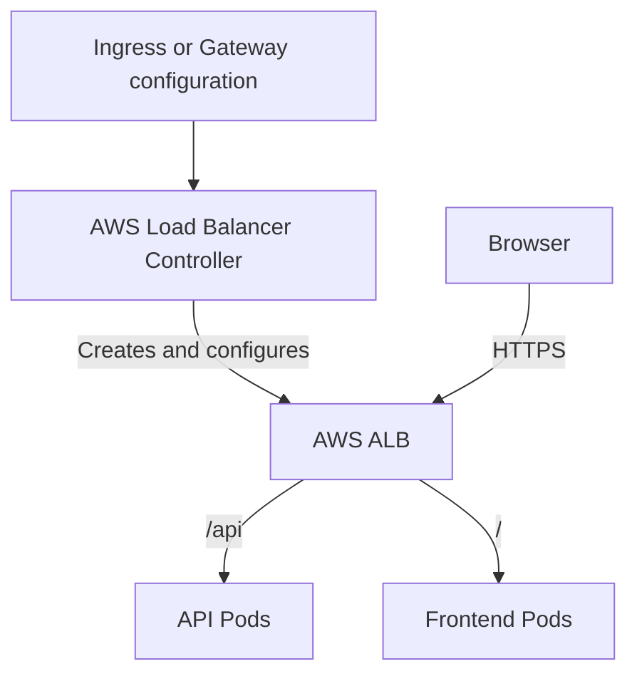

# AWS & EKS Fundamentals — Study Notes

A practical introduction to the AWS services around Amazon EKS, including networking, IAM, worker nodes, load balancing, persistent storage, scaling, and deployment tools.

**Running example:** a web application with a frontend, an API, a database, and uploaded files.

**Core idea:** EKS runs Kubernetes on AWS. AWS services supply the compute, network, permissions, traffic entry points, and storage that the application uses.

## Contents

1. [AWS infrastructure basics](#1-aws-infrastructure-basics)
2. [VPC networking](#2-vpc-networking)
3. [Security groups and network ACLs](#3-security-groups-and-network-acls)
4. [IAM and temporary credentials](#4-iam-and-temporary-credentials)
5. [What EKS manages](#5-what-eks-manages)
6. [EC2 and worker capacity](#6-ec2-and-worker-capacity)
7. [ECR and command-line tools](#7-ecr-and-command-line-tools)
8. [ALB versus NLB](#8-alb-versus-nlb)
9. [Kubernetes load-balancer integration](#9-kubernetes-load-balancer-integration)
10. [EBS, EFS, and S3](#10-ebs-efs-and-s3)
11. [PVCs, PVs, and CSI drivers](#11-pvcs-pvs-and-csi-drivers)
12. [Access to EKS and AWS services](#12-access-to-eks-and-aws-services)
13. [Networking inside EKS](#13-networking-inside-eks)
14. [Pod scaling and node scaling](#14-pod-scaling-and-node-scaling)
15. [Supporting AWS services](#15-supporting-aws-services)
16. [Terraform, CI/CD, and GitOps](#16-terraform-cicd-and-gitops)
17. [Azure-to-AWS comparisons](#17-azure-to-aws-comparisons)
18. [Practice checklist](#18-practice-checklist)
19. [Official references](#19-official-references)

## 1. AWS infrastructure basics

| Concept | Meaning | Example |
| --- | --- | --- |
| AWS account | Resource, permission, and billing boundary | Contains your EKS infrastructure |
| Region | Geographical area of AWS infrastructure | Mumbai: `ap-south-1` |
| Availability Zone (AZ) | Isolated infrastructure location within a Region | Spread workers across AZs |
| ARN | Identifier for an AWS resource | Identifies a particular IAM role |
| Tags | Labels attached to resources | `Environment=dev` |

A Region contains multiple Availability Zones. Distributing application replicas across AZs can improve availability, provided the application and its dependencies are designed accordingly.

Tags help organize resources, allocate costs, and support automation. They are separate from Kubernetes labels.

**Costs:** EKS has a cluster charge, and supporting resources such as EC2 instances, disks, load balancers, NAT gateways, and public IPv4 addresses may add charges. Set budget alerts and review all resources when cleaning up a lab.

## 2. VPC networking

A **Virtual Private Cloud (VPC)** is your logically isolated AWS network. It is comparable to an Azure VNet.

| Component | Purpose | EKS connection |
| --- | --- | --- |
| CIDR range | Defines the network address range | Supplies addresses for infrastructure and Pods |
| Subnet | A smaller address range in one AZ | Hosts nodes and other resources |
| Route table | Determines where traffic goes | Controls local and external routes |
| Internet Gateway | Connects a VPC to the internet | Supports direct internet connectivity |
| NAT Gateway | Provides outbound connectivity from private resources | Lets private nodes reach external services |
| VPC endpoint | Private access to supported AWS services | Can supply private access to ECR and other services |
| ENI | Elastic Network Interface: a virtual network interface | Connects instances and networking integrations |

### Public and private subnets

- A **public subnet** has a route to an Internet Gateway.
- A **private subnet** has no direct route to an Internet Gateway.
- Being in a public subnet does not automatically expose a resource. Public addressing, routes, and security rules also matter.
- A private resource can initiate internet connections through an appropriately configured public NAT Gateway.

A common arrangement for an internet-facing application is:

- Internet-facing load balancers in public subnets.
- Worker nodes in private subnets.
- Resources distributed across multiple AZs.
- NAT or appropriate VPC endpoints for outbound service access.

EKS requires cluster subnets in at least two different Availability Zones. Plan enough available IP addresses for the cluster, nodes, Pods, and supporting resources.

**Understand this traffic path:** a private node downloading an image needs a valid network route and permission to access the image registry.

## 3. Security groups and network ACLs

These control network traffic at different boundaries.

| Feature | Security group | Network ACL |
| --- | --- | --- |
| Boundary | Associated network interfaces/resources | Subnet |
| Rules | Allow rules | Allow and deny rules |
| Connection tracking | Stateful | Stateless |
| Return traffic | Automatically allowed for permitted connections | Needs suitable rules |
| Common use | Resource-to-resource access | Additional subnet restrictions |

**Example:** allow clients to reach an ALB on HTTPS port `443`, then allow the ALB to reach application targets on port `8080`.

Security groups and network ACLs address connectivity. IAM policies address permission to perform AWS actions.

## 4. IAM and temporary credentials

**Identity and Access Management (IAM)** controls authentication and authorization for AWS resources.

| Concept | Meaning |
| --- | --- |
| User | Identity created in an AWS account |
| Group | Collection of IAM users |
| Role | Identity that trusted people or services can assume |
| Permission policy | Defines allowed or denied actions on resources |
| Trust policy | Defines who or what can assume a role |
| STS | Security Token Service; issues temporary credentials |
| IAM Identity Center | Centralized workforce access and SSO |
| MFA | Additional sign-in verification |
| Least privilege | Grant only the permissions needed |

A permission policy commonly contains:

- `Effect`: allow or deny.
- `Action`: the AWS operation.
- `Resource`: the resources covered.
- `Condition`: optional restrictions.

**Example:** give an application role permission to upload objects to one S3 bucket. Configure the trust relationship so the intended workload can obtain that role's temporary credentials.

Prefer temporary credentials for people and workload roles for applications. Protect the root identity and use suitable identities for routine work.

## 5. What EKS manages

**Amazon Elastic Kubernetes Service (EKS)** is AWS's managed Kubernetes service.

The **control plane** includes the API server, scheduler, controllers, and etcd. The **data plane** supplies the compute where application Pods run.

| Compute option | Management approach |
| --- | --- |
| Managed node groups | EKS helps provision and manage groups of EC2 workers |
| Self-managed nodes | You take more responsibility for provisioning and operating workers |
| Fargate | AWS runs eligible Pods without you managing EC2 workers |
| EKS Auto Mode | AWS manages more worker infrastructure and integrations |

EKS Auto Mode covers capabilities such as worker provisioning, scaling, operating-system patching, networking, load balancing, and block-storage integration.

You still configure application workloads, permissions, resource requests, availability, and application behavior.

**Operations to learn:** Kubernetes version upgrades, compatible add-on versions, worker updates, disruption budgets, and application validation after changes.

## 6. EC2 and worker capacity

An **EC2 instance** is a virtual machine. In a conventional EC2-backed EKS cluster, it becomes a Kubernetes worker node.

| EC2 concept | Why it matters |
| --- | --- |
| Instance type | Determines CPU, memory, architecture, and other capabilities |
| AMI | Machine image containing the operating system and initial software |
| EBS root disk | Stores the operating system and local data |
| Instance IAM role | Gives the instance AWS permissions |
| Launch template | Defines settings for launching instances |
| Auto Scaling Group | Maintains capacity within minimum and maximum limits |
| On-Demand | Capacity purchased without Spot interruption behavior |
| Spot | Discounted capacity that AWS can interrupt |
| SSH / Session Manager | Ways to access suitable EC2 instances for administration |

Managed node groups use EC2 Auto Scaling Groups. Creating a node group alone does not provide workload-aware automatic scaling; configure a suitable scaling mechanism.

### How many Pods fit on a node?

Capacity depends on several constraints together:

- Allocatable CPU and memory.
- Pod resource requests and system overhead.
- Configured maximum Pod count.
- Networking limits and available Pod IP addresses.
- Other requirements such as storage, GPUs, labels, and taints.

An EC2 instance's CPU and memory are only part of the answer.

## 7. ECR and command-line tools

**Elastic Container Registry (ECR)** stores container images. It is comparable to Azure Container Registry.

The image workflow is:

1. Build an image using Docker or Podman.
2. Tag it with the ECR repository address.
3. Push the image.
4. Reference it in a Kubernetes Deployment.
5. The worker environment pulls the image and starts the container.

| Tool | Main job |
| --- | --- |
| AWS CLI | Operate AWS services and authenticate |
| kubectl | Operate Kubernetes resources |
| eksctl | Create and manage EKS infrastructure |
| Helm | Install and manage Kubernetes application packages |

Example commands for an existing cluster:

```bash
# Check which AWS identity the terminal is using.
aws sts get-caller-identity

# Add/update connection configuration for an existing EKS cluster.
aws eks update-kubeconfig --region ap-south-1 --name my-cluster

# Ask the Kubernetes API for worker nodes.
kubectl get nodes
```

Replace the Region and cluster name with your values. Updating kubeconfig prepares connection settings; it does not automatically grant cluster access.

Learn CLI profiles and Region selection so you can identify which account, identity, and environment a command targets.

## 8. ALB versus NLB

Both belong to **Elastic Load Balancing (ELB)**, AWS's load-balancer service family.

| Feature | ALB | NLB |
| --- | --- | --- |
| Full name | Application Load Balancer | Network Load Balancer |
| Main level | Layer 7: HTTP requests | Layer 4: network connections |
| Main traffic | HTTP, HTTPS, gRPC | TCP, UDP, TLS |
| Routing decisions | Host, path, and other request properties | Connection/listener information |
| Example | Route `/api` and `/` to different applications | Expose a TCP service on port `9000` |
| Addressing | Normally accessed by DNS name | Static addresses per enabled AZ |

### ALB example

An ALB can route:

- `example.com/api` to API Pods.
- `example.com/` to frontend Pods.
- `admin.example.com` to an administration application.

Think of it as a receptionist who reads which department a request is for.

### NLB example

An NLB can receive TCP connections on a configured port and distribute them to application targets.

It can carry HTTPS traffic, but it does not choose destinations by inspecting HTTP URL paths in the way an ALB does.

### Terms used with both

| Term | Meaning |
| --- | --- |
| Listener | Port and protocol accepting incoming traffic |
| Target group | Backend destinations receiving traffic |
| Health check | Test used to determine whether a target is healthy |
| Internet-facing | Load balancer reachable through public connectivity |
| Internal | Load balancer using private connectivity |

Load balancers route traffic to healthy registered targets.

## 9. Kubernetes load-balancer integration

The **AWS Load Balancer Controller** watches Kubernetes configuration and manages corresponding AWS resources.

| Kubernetes configuration | AWS resource |
| --- | --- |
| Ingress handled by the ALB controller | ALB |
| Gateway API configuration handled by a supported controller version | ALB |
| LoadBalancer Service handled by the controller | NLB |

The selected controller, resource classes, supported version, and configuration determine the outcome.



The diagram illustrates routing using Pod IP targets. The Kubernetes Service identifies the backend workload in configuration.

**The controller configures the load balancer. Application traffic does not pass through the controller.**

### Target types

| Target type | Traffic path |
| --- | --- |
| IP | Load balancer sends traffic directly to Pod IP targets |
| Instance | Load balancer sends traffic through a node's NodePort |

EKS Auto Mode supplies managed load-balancing integration with its own configuration conventions. Follow instructions for your selected mode.

Gateway API is a configuration API. A compatible controller is what turns that configuration into working infrastructure.

## 10. EBS, EFS, and S3

### EBS: a persistent disk

**Elastic Block Store (EBS)** supplies block storage, comparable to an Azure Managed Disk.

A workload can use a filesystem on an EBS volume for persistent data. The EBS volume and attached EC2 instance must be in the same AZ.

If a Pod moves to another node, scheduling and volume attachment must respect that constraint.

The common access mode is **ReadWriteOnce (RWO)**: writable from one node. Multiple Pods on that same node may still use it.

Specialized Multi-Attach configurations exist and require additional storage and application considerations.

### EFS: a shared filesystem

**Elastic File System (EFS)** supplies shared network file storage over NFS, broadly comparable to Azure Files.

Multiple Pods on different nodes can access a shared filesystem, commonly using **ReadWriteMany (RWX)**.

- Regional EFS stores data across multiple AZs.
- EFS also offers a One Zone option.
- Applications must coordinate concurrent file changes correctly.

### EBS versus EFS

| Feature | EBS | EFS |
| --- | --- | --- |
| Storage model | Block storage | Network filesystem |
| Analogy | Attached disk | Shared folder |
| Typical access pattern | One node writes | Multiple nodes share files |
| AZ consideration | Volume attachment stays within its AZ | Regional option supports access across AZs |
| EKS integration | EBS CSI driver | EFS CSI driver |

### S3: object storage

**Simple Storage Service (S3)** stores objects in buckets, comparable to Azure Blob Storage.

Applications usually upload and download objects through AWS SDKs or APIs. Use it for uploads, images, exports, and backups.

For the example application:

- Use EBS where a stateful workload needs a persistent disk.
- Use EFS where replicas need a shared filesystem.
- Use S3 where uploads can be handled as objects.

## 11. PVCs, PVs, and CSI drivers

| Kubernetes concept | Job |
| --- | --- |
| StorageClass | Defines how storage is provisioned |
| PVC | Requests storage for a workload |
| CSI driver | Performs storage operations against AWS |
| PV | Represents provisioned or available storage |
| Pod volume mount | Makes storage available inside a container |

For EBS dynamic provisioning:

1. A PVC requests capacity using a StorageClass.
2. The CSI provisioning integration creates an EBS volume.
3. A PV represents that volume in Kubernetes.
4. Kubernetes binds the PVC and PV.
5. The workload uses the storage through its volume configuration.

A **PV is a Kubernetes object representing storage**. An EBS volume or EFS filesystem supplies the underlying storage.

S3 is usually accessed by the application as object storage. Do not assume that a normal EBS/EFS StorageClass or PVC automatically provides S3 access.

### Things to remember

- Data on persistent storage can survive Pod replacement.
- Deleting a PVC may delete its storage, depending on the PV reclaim policy.
- With EBS, `WaitForFirstConsumer` volume binding helps align provisioning with workload placement.
- EKS Auto Mode manages its block-storage integration.
- EBS volumes cannot be mounted to Fargate Pods.
- EFS has a supported Fargate integration; provisioning capabilities differ from EC2-backed nodes.

## 12. Access to EKS and AWS services

Different permission relationships serve different purposes.

| Relationship | Mechanism to learn |
| --- | --- |
| Developer to AWS | IAM authentication and permissions |
| Developer to Kubernetes API | EKS access entries, access policies, and Kubernetes RBAC |
| Worker node to AWS | Node IAM role |
| Application Pod to AWS | EKS Pod Identity or IRSA |

### Cluster access

**EKS access entries** associate supported IAM identities with access to the Kubernetes API. Authorization can use EKS access policies and/or Kubernetes RBAC configuration.

For example, a developer might be permitted to inspect resources while another identity can administer the cluster.

### Pod access to AWS

**EKS Pod Identity** and **IAM Roles for Service Accounts (IRSA)** connect workload identities to IAM permissions.

Example:

1. The upload API uses a Kubernetes ServiceAccount.
2. An identity integration associates that workload with an IAM role.
3. The role permits access to the required S3 bucket.
4. A supported AWS SDK uses temporary credentials.

A Kubernetes ServiceAccount by itself does not grant S3 permissions.

## 13. Networking inside EKS

| Component | Purpose |
| --- | --- |
| Amazon VPC CNI | Supplies Pod networking and VPC IP addresses |
| CoreDNS | Resolves Kubernetes service names |
| kube-proxy | Implements Service forwarding in conventional configurations |
| NetworkPolicy | Defines permitted Pod traffic with supporting implementation |
| API endpoint configuration | Controls public/private access to the Kubernetes API |

With the usual VPC CNI setup, Pods receive VPC addresses. Available subnet addresses and instance networking limits affect Pod capacity.

A service name such as `api.default.svc.cluster.local` is resolved by Kubernetes DNS.

The Kubernetes API endpoint is separate from your application's ALB/NLB entry point. Securing access to the application and securing access to the cluster API are separate tasks.

Auto Mode manages its networking components.

## 14. Pod scaling and node scaling

| Mechanism | What changes |
| --- | --- |
| HPA | Number of Pod replicas |
| VPA | Pod resource requests according to its configuration |
| Cluster Autoscaler | Node-group capacity |
| Karpenter | Provisions and consolidates suitable worker capacity |
| EKS Auto Mode | Supplies managed worker provisioning and scaling |

### Example

1. The API begins with three replicas.
2. HPA increases the desired replicas to ten.
3. Existing workers cannot fit all the requested Pods.
4. A node-scaling mechanism provisions capacity.
5. Pending Pods can be scheduled when suitable capacity becomes available.

HPA and worker scaling address different layers. Correct resource requests and suitable metrics are essential.

Cluster Autoscaler works with configured node groups. Karpenter can provision suitable instances from configured requirements. Auto Mode provides broader managed infrastructure capabilities.

## 15. Supporting AWS services

| Service or topic | Contribution |
| --- | --- |
| Route 53 | DNS records connecting domains to load balancers |
| ACM | TLS certificates for supported AWS integrations |
| Secrets Manager | Stores application credentials and secrets |
| KMS | Manages encryption keys and key-use permissions |
| CloudWatch | Metrics, logs, dashboards, and alarms |
| CloudTrail | Records AWS API activity |
| Kubernetes audit logs | Record Kubernetes API activity |
| Prometheus/Grafana | Collect and visualize metrics |
| RDS | Managed relational database for the application |
| Budgets and cost review | Help track infrastructure spending |

### Logging distinctions

- **CloudTrail:** who changed an AWS resource or EKS configuration?
- **Kubernetes audit logs:** who performed an operation such as deleting a Deployment?
- **Application logs:** why did an application request fail?
- **Metrics:** how much CPU, memory, or capacity is being used?

EKS can send control-plane logs to CloudWatch. Application log collection needs suitable configuration.

### DNS and HTTPS example

A Route 53 record points your application domain toward the load balancer. An ACM certificate can supply TLS for the load balancer's HTTPS listener.

TLS between the load balancer and backend is a separate configuration decision from client-to-load-balancer TLS.

## 16. Terraform, CI/CD, and GitOps

| Tool | Responsibility |
| --- | --- |
| Terraform | Provision VPCs, IAM roles, EKS, and other AWS infrastructure |
| GitHub Actions | Build, test, and push container images |
| Helm | Package Kubernetes applications |
| Kustomize | Customize Kubernetes manifests |
| Argo CD | Reconcile Kubernetes configuration from Git |

Example delivery workflow:

1. A developer commits application code.
2. CI builds and tests an image.
3. CI pushes the image to ECR.
4. Deployment configuration is updated with the intended image reference.
5. Argo CD reconciles that configuration into EKS.
6. Kubernetes runs the new workload version.

Terraform creates infrastructure; Kubernetes controllers reconcile application resources and integrations.

## 17. Azure-to-AWS comparisons

These are approximate comparisons. Configuration, identity, and service behavior differ.

| Azure concept | AWS counterpart |
| --- | --- |
| Virtual Network | VPC |
| Virtual Machine | EC2 |
| Virtual Machine Scale Sets | EC2 Auto Scaling Groups |
| Azure Container Registry | ECR |
| Managed Disks | EBS |
| Azure Files | EFS |
| Blob Storage | S3 |
| AKS | EKS |
| Azure DNS | Route 53 DNS hosting |
| Azure Monitor | CloudWatch, broadly |

IAM, Microsoft Entra ID, Azure RBAC, and managed identities have overlapping purposes but do not map one-to-one. Learn AWS IAM's policy and trust model explicitly.

## 18. Practice checklist

### AWS preparation

- [ ] Identify the active AWS account, identity, and Region.
- [ ] Read a basic IAM permission policy and role trust policy.
- [ ] Build a VPC with public and private subnets across two AZs.
- [ ] Explain routes, Internet Gateway, NAT, and VPC endpoints.
- [ ] Configure security groups for a simple application.
- [ ] Launch an EC2 instance with a suitable IAM role.
- [ ] Build a container image and push it to ECR.

### EKS integrations

- [ ] Create a cluster and configure kubectl access.
- [ ] Deploy an application from ECR.
- [ ] Expose an HTTP application through an ALB.
- [ ] Expose a sample TCP service through an NLB.
- [ ] Inspect listeners, target groups, and health checks.
- [ ] Provision an EBS-backed PVC.
- [ ] Try a shared EFS volume.
- [ ] Give a workload S3 access using Pod Identity or IRSA.
- [ ] Configure logs, metrics, and useful alarms.
- [ ] Observe HPA and worker scaling as separate processes.

### Deployment and operations

- [ ] Rebuild the infrastructure using Terraform.
- [ ] Build and push images through CI.
- [ ] Deploy configuration through Argo CD.
- [ ] Review add-on and Kubernetes version compatibility.
- [ ] Test workload behavior during worker replacement.
- [ ] Review spending and remove unused lab resources.

## 19. Official references

### AWS foundations

- [Amazon VPC overview](https://docs.aws.amazon.com/vpc/latest/userguide/what-is-amazon-vpc.html)
- [IAM overview](https://docs.aws.amazon.com/IAM/latest/UserGuide/introduction.html)
- [IAM security best practices](https://docs.aws.amazon.com/IAM/latest/UserGuide/best-practices.html)
- [Amazon EKS pricing](https://aws.amazon.com/eks/pricing/)

### EKS, identity, and networking

- [What is Amazon EKS?](https://docs.aws.amazon.com/eks/latest/userguide/what-is-eks.html)
- [Set up to use EKS](https://docs.aws.amazon.com/eks/latest/userguide/setting-up.html)
- [EKS VPC and subnet requirements](https://docs.aws.amazon.com/eks/latest/userguide/network-reqs.html)
- [Managed node groups](https://docs.aws.amazon.com/eks/latest/userguide/managed-node-groups.html)
- [EKS access control](https://docs.aws.amazon.com/eks/latest/userguide/cluster-auth.html)
- [Workload access using ServiceAccounts](https://docs.aws.amazon.com/eks/latest/userguide/service-accounts.html)
- [Amazon VPC CNI](https://docs.aws.amazon.com/eks/latest/userguide/managing-vpc-cni.html)

### Traffic, storage, and operations

- [EKS load-balancing guidance](https://docs.aws.amazon.com/eks/latest/best-practices/load-balancing.html)
- [AWS Load Balancer Controller](https://docs.aws.amazon.com/eks/latest/userguide/aws-load-balancer-controller.html)
- [ALB configuration with EKS Auto Mode](https://docs.aws.amazon.com/eks/latest/userguide/auto-configure-alb.html)
- [EBS volumes](https://docs.aws.amazon.com/ebs/latest/userguide/ebs-volumes.html)
- [EBS CSI integration](https://docs.aws.amazon.com/eks/latest/userguide/ebs-csi.html)
- [EFS CSI integration](https://docs.aws.amazon.com/eks/latest/userguide/efs-csi.html)
- [Cluster Autoscaler guidance](https://docs.aws.amazon.com/eks/latest/best-practices/cas.html)
- [Monitoring and logging on EKS](https://docs.aws.amazon.com/eks/latest/userguide/eks-observe.html)
