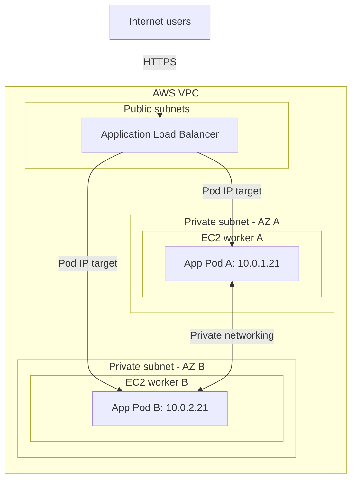

# AWS EKS Networking

In the usual EKS setup, Kubernetes networking connects directly to your AWS VPC. Both EC2 worker nodes and application Pods receive private IP addresses from your VPC.

This guide explains a typical **Linux, IPv4 EKS cluster with EC2 workers and the Amazon VPC CNI**. Other networking configurations can behave differently.

## 1. VPC, subnets, and worker nodes

A **VPC (Virtual Private Cloud)** is your private network in AWS. **Subnets** divide its address space into smaller ranges. Each subnet belongs to one Availability Zone.

Your EC2 worker nodes are launched into these subnets. A common arrangement places workers in private subnets across multiple Availability Zones and internet-facing load balancers in public subnets.

| Resource | Example address or range |
|---|---|
| VPC | `10.0.0.0/16` |
| Private subnet in AZ A | `10.0.1.0/24` |
| EC2 worker in AZ A | `10.0.1.10` |
| Application Pod on that worker | `10.0.1.21` |
| Private subnet in AZ B | `10.0.2.0/24` |
| EC2 worker in AZ B | `10.0.2.10` |
| Application Pod on that worker | `10.0.2.21` |

These addresses are illustrative. By default, the VPC CNI assigns Pod addresses from the node's subnet. Custom networking and other supported configurations can use different Pod subnets.

Reference: [Configure subnet selection for Pod IP addresses](https://docs.aws.amazon.com/eks/latest/userguide/cni-subnet-selection.html).

## 2. How Pods get IP addresses

The **Amazon VPC CNI** provides Pod networking and allocates VPC IP addresses to Pods.

An EC2 instance has one or more **ENIs (Elastic Network Interfaces)**. Think of an ENI as a virtual network card. An ENI can carry multiple private IP addresses.

When an application Pod starts:

1. The Kubernetes scheduler selects a worker node.
2. During Pod setup, the VPC CNI allocates an available VPC IP address.
3. It configures the Pod's interface and the networking on the worker.
4. The Pod communicates using its private IP address.

**Each Pod does not require a separate EC2 ENI.** Multiple Pod IP addresses can be associated with a worker's ENIs. The CNI maintains a pool of available addresses or prefixes and can attach additional ENIs within the instance's limits.

Containers inside the same Pod share its network namespace and can communicate using `localhost` and different ports. Pods configured with `hostNetwork: true` share the node's network namespace instead of receiving the usual separate Pod networking.

Reference: [Amazon VPC CNI](https://docs.aws.amazon.com/eks/latest/best-practices/vpc-cni.html).

## 3. How Pods communicate

### Pods on the same worker

Traffic passes through the worker's local networking between the Pods. It does not need a public load balancer or an internet connection.

### Pods on different workers

Traffic passes through the source worker's networking, across the private VPC network, and into the destination worker and Pod.

For example, Pod A at `10.0.1.21` can communicate with Pod B at `10.0.2.21`, provided the relevant network and security rules allow it.

With the standard VPC CNI setup, Pod IP addresses are directly routable inside the VPC. An overlay tunnel is generally unnecessary. A connection between Pods does not need a NAT Gateway or the Kubernetes API server.

References: [Amazon VPC CNI](https://docs.aws.amazon.com/eks/latest/best-practices/vpc-cni.html), [Pod communication and source address translation](https://docs.aws.amazon.com/eks/latest/userguide/external-snat.html).

## 4. Services, CoreDNS, and kube-proxy

Pod IP addresses can change when Pods are replaced. Applications therefore usually communicate through **Kubernetes Services**.

A normal ClusterIP Service provides a stable virtual IP and a DNS name. For example, a frontend Pod can call:

```text
http://backend-service.production.svc.cluster.local:8080
```

| Component | Job |
|---|---|
| **Service** | Provides a stable address for a changing set of backend Pods |
| **CoreDNS** | Resolves the Service name to its ClusterIP |
| **kube-proxy** | Typically configures forwarding rules that send Service traffic to backend Pod endpoints |
| **VPC CNI** | Provides Pod IP allocation and connectivity |

The connection works as follows:

1. The frontend asks DNS for the backend Service's address.
2. CoreDNS resolves the normal Service name to its ClusterIP.
3. The frontend connects to that ClusterIP and port.
4. Service forwarding rules select a backend Pod endpoint.
5. Traffic reaches that Pod over the node and VPC networking as needed.

**A Service ClusterIP is a Kubernetes virtual address, separate from the VPC addresses assigned to nodes and Pods.** CoreDNS resolves names; the application connection then follows the Service forwarding rules.

Headless Services work differently: they expose endpoint addresses through DNS without allocating the normal ClusterIP.

References: [Kubernetes Services](https://kubernetes.io/docs/concepts/services-networking/service/), [Virtual IPs and Service proxies](https://kubernetes.io/docs/reference/networking/virtual-ips/).

## 5. How internet users reach your application

A public application can use an internet-facing AWS load balancer while its worker nodes and Pods remain in private subnets.

This diagram shows an ALB forwarding directly to Pod IP targets. It groups the ALB's public subnets together for readability.



### ALB versus NLB

| Load balancer | Typical purpose | Common Kubernetes integration |
|---|---|---|
| **ALB** | HTTP/HTTPS routing by hostname or URL path | An appropriately configured `Ingress` |
| **NLB** | TCP/UDP traffic | An appropriately configured Service with `type: LoadBalancer` |

With the **AWS Load Balancer Controller**, supported Kubernetes resources trigger creation and configuration of AWS load balancers. EKS Auto Mode provides its own managed load balancing integration.

Creating an Ingress alone requires a matching controller or managed integration to implement it.

### IP targets versus instance targets

| Target type | Traffic path |
|---|---|
| **IP** | Load balancer forwards directly to a Pod's IP and port |
| **Instance** | Load balancer forwards to a worker's NodePort, then Service forwarding sends traffic to a Pod |

For IP targets, an Ingress still references a Kubernetes Service to describe the backend, but the actual load balancer connection can bypass the Service's ClusterIP.

References: [AWS Load Balancer Controller](https://docs.aws.amazon.com/eks/latest/userguide/aws-load-balancer-controller.html), [Load balancing best practices](https://docs.aws.amazon.com/eks/latest/best-practices/load-balancing.html), [Auto Mode networking and load balancing](https://docs.aws.amazon.com/eks/latest/userguide/auto-networking.html).

## 6. How Pods access the internet and AWS services

For a Pod in a private subnet calling an external API, a typical IPv4 path is:

**Pod → node networking → public NAT Gateway → Internet Gateway → external API**

With the default VPC CNI IPv4 configuration, traffic leaving the VPC generally has its source translated from the Pod IP to the node's primary private IP. The public NAT Gateway then translates outbound traffic to its public address. Configuration changes can alter where source translation happens.

The NAT Gateway enables outbound connections and their replies. Publishing an application for inbound requests normally uses a load balancer instead.

For supported AWS services, **VPC endpoints** provide private access without sending the connection through a public internet endpoint. For example, a private cluster can use the required endpoints for services such as ECR and S3, with suitable routing, policies, and security rules.

References: [Outbound internet access for Pods](https://docs.aws.amazon.com/eks/latest/userguide/external-snat.html), [NAT gateways](https://docs.aws.amazon.com/vpc/latest/userguide/vpc-nat-gateway.html), [Private clusters](https://docs.aws.amazon.com/eks/latest/userguide/private-clusters.html).

## 7. What controls network access

Being reachable by IP does not automatically mean a connection is allowed. AWS and Kubernetes controls determine which traffic can pass.

| Control | Scope | Example |
|---|---|---|
| **Route tables** | Network paths associated with subnets | Send outbound internet traffic from a private subnet to a NAT Gateway |
| **Security groups** | Stateful filtering for AWS network interfaces and supported Pod configurations | Allow the load balancer to reach the application port |
| **Network ACLs** | Stateless filtering at subnet boundaries | Restrict traffic entering or leaving a subnet |
| **NetworkPolicies** | Selected Pods, when supported enforcement is enabled | Allow frontend Pods to connect to backend Pods on port `8080` |

For example, you could allow public HTTPS requests to the ALB, allow the ALB to reach your application, and restrict backend access to the intended frontend Pods.

**Namespaces alone do not isolate network traffic.** Use supported network policy enforcement and the appropriate AWS rules to enforce isolation.

References: [EKS network security](https://docs.aws.amazon.com/eks/latest/best-practices/network-security.html), [Kubernetes network policies on EKS](https://docs.aws.amazon.com/eks/latest/userguide/cni-network-policy.html).

## 8. Control plane networking

Your EKS cluster has a **Kubernetes API endpoint**. Management tools such as `kubectl`, along with worker components such as kubelets, communicate with the control plane through this endpoint.

| API endpoint configuration | Meaning |
|---|---|
| **Public** | The API endpoint is reachable through public networking, subject to configured access restrictions |
| **Private** | Clients need connectivity from the VPC or a connected network |
| **Public and private** | Both access paths are enabled |

Network connectivity is separate from authentication and authorization: a reachable API endpoint still requires the appropriate credentials and permissions.

The API endpoint configuration is also separate from application exposure. Your application can have a public load balancer while the Kubernetes API endpoint remains private.

Normal user requests go through the application's networking path. They do not pass through the Kubernetes API server.

Reference: [EKS cluster API server endpoint](https://docs.aws.amazon.com/eks/latest/userguide/cluster-endpoint.html).

## 9. How networking affects Pod capacity

An EC2 worker's practical Pod capacity depends on more than CPU and memory.

| Constraint | Effect |
|---|---|
| **CPU and memory** | Pods need sufficient allocatable resources for their requests |
| **Configured Pod limit** | Kubernetes limits the number of Pods on a node |
| **ENI and IP capacity** | The instance and CNI configuration constrain available Pod addresses |
| **Subnet address availability** | The subnet needs enough free addresses for networking allocations |
| **System overhead** | Node services and system Pods consume resources |

With secondary IP allocation, instance ENI and address limits affect Pod density. **Prefix delegation** can increase the IP capacity available through ENIs, within supported instance and configuration limits.

If Karpenter or EKS Auto Mode launches more workers into a subnet that has exhausted its available addresses, additional EC2 capacity alone may not resolve Pod networking failures.

References: [EKS networking best practices](https://docs.aws.amazon.com/eks/latest/best-practices/networking.html), [Assign more IP addresses using prefixes](https://docs.aws.amazon.com/eks/latest/userguide/cni-increase-ip-addresses.html).

## 10. Quick revision

| Term | Remember it as |
|---|---|
| **VPC** | Your AWS private network |
| **Subnet** | An address range inside that network, in one Availability Zone |
| **ENI** | An EC2 virtual network card |
| **VPC CNI** | Pod IP allocation and connectivity |
| **Pod IP** | The address used to reach a particular Pod |
| **Service** | A stable way to reach a changing group of Pods |
| **CoreDNS** | Resolves Kubernetes Service names |
| **kube-proxy** | Typically implements Service forwarding rules |
| **ALB** | HTTP/HTTPS application routing |
| **NLB** | TCP/UDP load balancing |
| **NAT Gateway** | Outbound access from private IPv4 workloads |
| **VPC endpoint** | Private connectivity to supported AWS services |
| **Security groups** | AWS network access rules |
| **NetworkPolicy** | Kubernetes Pod traffic rules, with an enforcing network implementation |
| **EKS API endpoint** | The connection used to manage the Kubernetes cluster |
