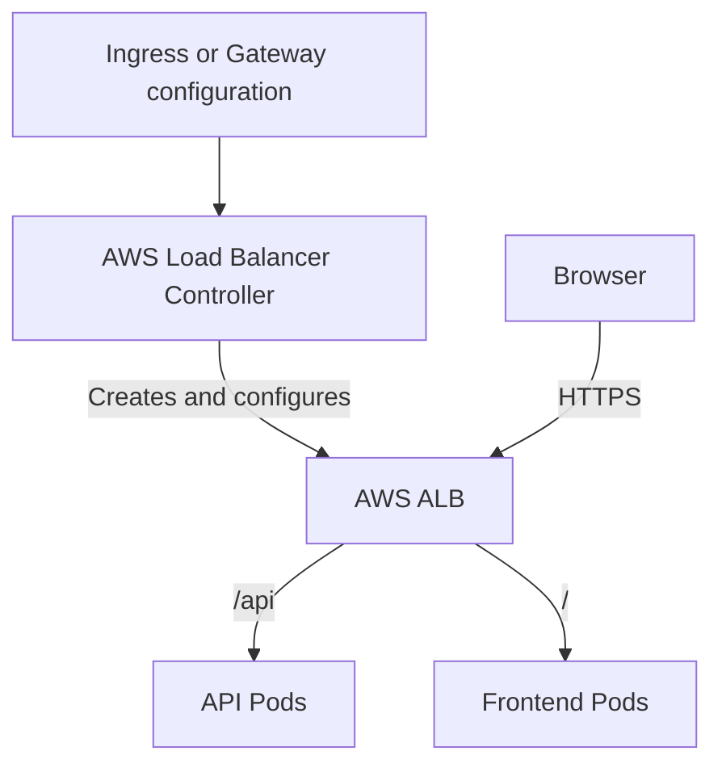
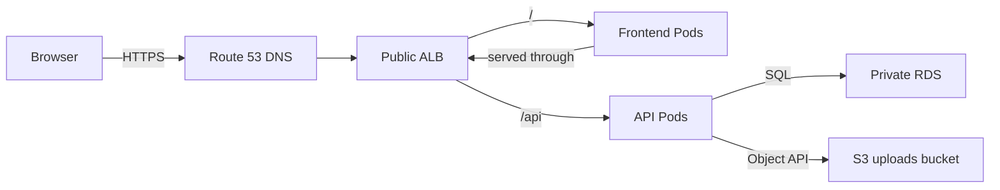

# AWS and EKS Learning Guide: Deploying a Web Application

A practical guide to the AWS infrastructure around Amazon EKS, using a web application with a frontend, an API, and uploaded files as the running example.

> **Big picture:** EKS runs Kubernetes on AWS. AWS provides the machines, networking, permissions, load balancers, and storage that the application needs. ALB, NLB, EBS, and EFS are AWS services that integrate with Kubernetes.

## 1. AWS foundations

| Concept | Simple explanation | Example |
|---|---|---|
| AWS account | Boundary for resources, permissions, and billing | Your account contains your EKS resources |
| Region | Geographical area containing AWS infrastructure | Mumbai: `ap-south-1` |
| Availability Zone (AZ) | Isolated infrastructure location within a Region | Spread workers across AZs for availability |
| ARN | Identifier for an AWS resource | An IAM role ARN identifies a particular role |
| Tags | Labels attached to AWS resources | `Environment=dev`, `Project=swiftpay` |

An AWS Region is roughly comparable to an Azure Region. Availability Zones serve a similar purpose in both clouds.

## 2. VPC networking

Think of a **VPC as your application's private network**, comparable to an Azure VNet.

| Component | What it does | Connection to EKS |
|---|---|---|
| CIDR range | Defines available IP addresses, such as `10.0.0.0/16` | You need enough addresses for infrastructure and Pods |
| Subnet | Divides the VPC into smaller address ranges; each subnet belongs to one AZ | Nodes and load balancers use subnets |
| Public subnet | Has a route to an Internet Gateway | Common location for internet-facing load balancers |
| Private subnet | Has no direct route to an Internet Gateway | Common location for worker nodes |
| Route table | Determines where network traffic goes | Directs traffic locally, toward NAT, or elsewhere |
| Internet Gateway (IGW) | Connects the VPC to the internet | Supports public internet connectivity |
| NAT Gateway | Enables outbound connections from private resources | Private nodes can download images or reach external APIs |
| VPC endpoint | Provides private connectivity to supported AWS services | Access services such as ECR without an internet route |
| ENI | Virtual network interface | Used by nodes and AWS networking integrations |

A public subnet alone does not make every resource inside it publicly accessible; addressing and security rules also matter. [Amazon VPC documentation](https://docs.aws.amazon.com/vpc/latest/userguide/what-is-amazon-vpc.html)

A common internet-facing application layout is:

- Load balancer in public subnets.
- Worker nodes in private subnets.
- Resources spread across multiple AZs.
- Outbound connectivity supplied through NAT or appropriate VPC endpoints.

EKS requires cluster subnets in at least two Availability Zones. [EKS network requirements](https://docs.aws.amazon.com/eks/latest/userguide/network-reqs.html)

### Security groups and network ACLs

| Feature | Security group | Network ACL |
|---|---|---|
| Applies to | Associated network interfaces/resources | Subnet boundary |
| Rules | Allow rules | Allow and deny rules |
| Connection tracking | Stateful: permitted connections have return traffic allowed | Stateless: return traffic needs matching rules |
| Typical use | Allow ALB traffic to application targets | Additional subnet-level restrictions |

For example, allow internet traffic to an ALB on port `443`, then allow application traffic from that ALB to the backend on port `8080`.

## 3. IAM and AWS permissions

Network access and IAM permission solve separate parts of connectivity. An application needs both a working network path to S3 and permission to read or write the objects.

| IAM concept | Meaning |
|---|---|
| User | An identity in an AWS account |
| Group | A collection of IAM users |
| Role | An identity that trusted people or services can assume |
| Permission policy | Defines allowed or denied actions on resources |
| Trust policy | Defines who or what can assume a role |
| STS | Issues temporary credentials |
| IAM Identity Center | Provides centralized workforce access and SSO |

A permission policy answers: **“Allow which action, on which resource, under which conditions?”** For example, a role could allow your API to upload files to one S3 bucket. AWS recommends temporary credentials and workload roles instead of distributing long-lived access keys. [IAM documentation](https://docs.aws.amazon.com/IAM/latest/UserGuide/introduction.html)

## 4. EKS control plane and compute choices

EKS manages the Kubernetes control plane, which includes components such as the API server, scheduler, controllers, and etcd. Your Pods run on the data plane.

| Compute option | What it means |
|---|---|
| Managed node groups | EKS helps provision and manage groups of EC2 worker instances |
| Self-managed nodes | You take more responsibility for provisioning and operating workers |
| Fargate | AWS runs eligible Pods without you managing EC2 worker instances |
| EKS Auto Mode | AWS manages more worker infrastructure and integrations, including scaling, networking, load balancing, and block storage |

You still configure workloads, application permissions, resource requests, and availability requirements. [What is Amazon EKS?](https://docs.aws.amazon.com/eks/latest/userguide/what-is-eks.html)

### EC2 concepts for worker nodes

An EC2 instance is a virtual machine, comparable to an Azure VM.

| EC2 concept | Why it matters |
|---|---|
| Instance type | Determines CPU, memory, architecture, and other capabilities |
| AMI | Machine image containing the operating system and initial software |
| EBS root disk | Stores the instance's operating system and local data |
| Instance IAM role | Gives the instance AWS permissions |
| Launch template | Defines settings used to launch instances |
| Auto Scaling Group (ASG) | Maintains a desired number of instances within minimum/maximum limits |
| On-Demand / Spot | Different capacity purchasing options; Spot can be interrupted |

With managed node groups, EKS organizes worker instances into EC2 Auto Scaling Groups. Creating a node group does not by itself provide workload-aware automatic scaling; that requires a scaling mechanism. [Managed node groups](https://docs.aws.amazon.com/eks/latest/userguide/managed-node-groups.html)

## 5. Container images and command-line tools

ECR stores your container images. A typical image workflow is:

1. Build an image using Docker or Podman.
2. Tag it with your ECR repository address.
3. Push it to ECR.
4. Reference that image in a Kubernetes Deployment.
5. The worker environment pulls the image and starts the container.

| Tool | Main job |
|---|---|
| AWS CLI | Operate AWS services and authenticate |
| `kubectl` | Operate Kubernetes resources |
| `eksctl` | Create and manage EKS infrastructure |
| Helm | Install and manage Kubernetes application packages |

For an existing cluster, you commonly configure access with:

```bash
aws sts get-caller-identity
aws eks update-kubeconfig --region ap-south-1 --name my-cluster
kubectl get nodes
```

Updating kubeconfig prepares the connection configuration; your identity still needs cluster permissions. [Connect kubectl to an EKS cluster](https://docs.aws.amazon.com/eks/latest/userguide/setting-up.html)

## 6. ALB and NLB

ALB and NLB are part of **Elastic Load Balancing (ELB)**, AWS's load-balancing service family.

| Feature | ALB — Application Load Balancer | NLB — Network Load Balancer |
|---|---|---|
| Main level | Layer 7: understands HTTP requests | Layer 4: handles network connections |
| Main traffic | HTTP, HTTPS, gRPC | TCP, UDP, TLS |
| Routing decisions | Can inspect hostname, URL path, and other request properties | Uses connection/listener information rather than HTTP paths |
| Example | Send `/api` to API Pods and `/` to frontend Pods | Expose a TCP application on port `9000` |
| Addressing | Normally accessed through its DNS name | Provides static addresses per enabled AZ |
| Typical reason to choose it | Web application routing | Transport-level traffic or static-IP requirements |

**ALB is like a receptionist who reads the requested department. NLB forwards connections to the appropriate listening service.** An NLB can handle HTTPS traffic, but it does not make HTTP URL-routing decisions like an ALB. [EKS load balancing best practices](https://docs.aws.amazon.com/eks/latest/best-practices/load-balancing.html)

For either load balancer, learn these building blocks:

- **Listener:** the port and protocol accepting incoming traffic.
- **Target group:** the backend destinations receiving that traffic.
- **Health check:** how AWS determines whether a target can receive traffic.
- **Scheme:** internet-facing or internal.

Load balancers route traffic to healthy registered targets. [Elastic Load Balancing](https://docs.aws.amazon.com/elasticloadbalancing/latest/userguide/what-is-load-balancing.html)

### Kubernetes controllers and load balancers

A controller connects Kubernetes configuration to AWS load balancer resources.

| Kubernetes configuration | AWS resource it can configure |
|---|---|
| Ingress handled by the ALB controller | ALB |
| Gateway API resources handled by a supported controller version | ALB |
| Service of type `LoadBalancer` handled by the controller | NLB |

The selected controller, classes, and configuration determine the result. Current AWS Load Balancer Controller versions support Gateway API as well as Ingress. [AWS Load Balancer Controller for EKS](https://docs.aws.amazon.com/eks/latest/userguide/aws-load-balancer-controller.html)



The diagram separates the configuration path from application traffic: the ALB is an AWS resource and the controller configures it. Traffic does not pass through the controller.

Also learn **target types**: IP targets can send traffic directly to Pod IPs, while instance targets send it through a node's NodePort. EKS Auto Mode supplies managed load-balancing integration with its own configuration conventions. [EKS load balancing best practices](https://docs.aws.amazon.com/eks/latest/best-practices/load-balancing.html)

## 7. EBS, EFS, and S3

| Feature | EBS | EFS | S3 |
|---|---|---|---|
| Storage model | Block storage: a virtual disk | Shared network filesystem | Object storage |
| Simple analogy | A disk attached to a machine | A shared folder accessed by multiple machines | A bucket of objects accessed through APIs |
| Common application use | Stateful workloads needing disk storage | Applications sharing filesystem data | Uploads, images, exports, backups |
| Kubernetes integration | EBS CSI driver | EFS CSI driver | Usually AWS SDK/API calls |
| Azure comparison | Managed Disks | Azure Files | Blob Storage |

**EBS** is useful when a workload needs its own persistent disk. The volume and attached EC2 instance must be in the same AZ. If a Pod moves to a different node, volume attachment and scheduling must respect that constraint. [Amazon EBS volumes](https://docs.aws.amazon.com/ebs/latest/userguide/ebs-volumes.html)

The common EBS access pattern is `ReadWriteOnce`: writable from **one node**, which can still host multiple Pods using it. Specialized Multi-Attach configurations exist, but require additional storage and application considerations.

**EFS** is useful when multiple Pods on different nodes need the same filesystem. It supports shared access, commonly expressed as `ReadWriteMany`. Regional EFS stores data across multiple AZs; EFS also offers a One Zone option. Applications still need to coordinate concurrent changes correctly. [EFS CSI driver on EKS](https://docs.aws.amazon.com/eks/latest/userguide/efs-csi.html)

For this example application:

- Give a stateful workload an EBS-backed disk when appropriate.
- Use EFS if replicas require a shared filesystem.
- Use S3 if uploads can be handled as objects through APIs.

### Kubernetes storage objects and CSI

| Kubernetes concept | Its job |
|---|---|
| StorageClass | Defines how storage should be provisioned |
| PVC | Requests storage for a workload |
| CSI driver | Performs storage operations against AWS |
| PV | Represents the provisioned or available storage |
| Pod volume mount | Makes the storage available inside the container |

For EBS dynamic provisioning, a PVC requests capacity, the EBS CSI driver creates the volume, and Kubernetes makes it available to the scheduled workload. Whether deleting a PVC also deletes its storage depends on the reclaim policy.

EKS Auto Mode manages its block-storage integration. EBS volumes cannot be mounted to Fargate Pods; EFS has a supported Fargate integration. [EBS CSI driver on EKS](https://docs.aws.amazon.com/eks/latest/userguide/ebs-csi.html)

## 8. EKS access and workload permissions

EKS access has several distinct permission relationships:

| Relationship | What to learn |
|---|---|
| Developer → AWS | IAM authentication and permissions |
| Developer → Kubernetes API | EKS access entries, access policies, and Kubernetes RBAC |
| Worker node → AWS | Node IAM role |
| Application Pod → AWS | EKS Pod Identity or IAM Roles for Service Accounts (IRSA) |

For example, give your upload API a Kubernetes ServiceAccount associated with an IAM role that permits access to its S3 bucket. Other workloads can use different roles.

Pod Identity and IRSA both provide ways to grant AWS permissions to workloads using Kubernetes ServiceAccounts. A Kubernetes ServiceAccount alone does not automatically grant S3 access. [IAM roles for service accounts](https://docs.aws.amazon.com/eks/latest/userguide/service-accounts.html)

## 9. EKS networking components

| Component | Purpose |
|---|---|
| Amazon VPC CNI | Provides Pod networking and assigns VPC addresses to Pods |
| CoreDNS | Resolves Kubernetes names such as `api.default.svc.cluster.local` |
| `kube-proxy` | Implements Service forwarding in conventional configurations |
| NetworkPolicy | Controls permitted traffic involving Pods, with a supporting implementation |
| API endpoint settings | Determine public/private connectivity to the Kubernetes API |

With the usual VPC CNI setup, Pods consume VPC address capacity. This is why subnet sizing and node network limits affect how many Pods you can run. Auto Mode manages its networking components. [Manage the VPC CNI add-on](https://docs.aws.amazon.com/eks/latest/userguide/managing-vpc-cni.html)

## 10. Scaling workloads and worker capacity

Application scaling and machine scaling happen at different levels.

| Mechanism | What changes |
|---|---|
| HPA | Number of Pod replicas |
| VPA | Pod resource requests, according to its configuration |
| Cluster Autoscaler | Node-group capacity |
| Karpenter | Provisions and consolidates suitable worker capacity |
| Auto Mode | Provides managed worker provisioning and scaling |

Example: HPA increases your API from 3 to 10 replicas. If existing nodes cannot accommodate those Pods, a node-scaling mechanism can provision capacity. Cluster Autoscaler specifically works with node groups and their Auto Scaling Groups. [Cluster Autoscaler best practices](https://docs.aws.amazon.com/eks/latest/best-practices/cas.html)

## 11. Supporting AWS services

| Service or topic | What it contributes |
|---|---|
| Route 53 | DNS records connecting your domain to the load balancer |
| ACM | TLS certificates for supported AWS integrations, including HTTPS load-balancer listeners |
| Secrets Manager | Stores application secrets such as database credentials |
| KMS | Manages encryption keys and permissions to use them |
| CloudWatch | Metrics, logs, dashboards, and alarms |
| CloudTrail | Records AWS API activity, such as changes to EKS configuration |
| Kubernetes audit logs | Record Kubernetes API activity, such as deleting a Deployment |
| Prometheus/Grafana | Collect and visualize application and infrastructure metrics |
| RDS | Provides a managed database your application can access |
| Budgets and cost review | Help track cluster and supporting infrastructure spend |

EKS can send control-plane logs to CloudWatch. Application log collection needs suitable configuration; CloudTrail and Kubernetes audit logs cover different API activity. [Monitor EKS clusters](https://docs.aws.amazon.com/eks/latest/userguide/eks-observe.html)

## 12. How the DevOps tools fit together

| Tool | Responsibility |
|---|---|
| Terraform | Create VPCs, IAM roles, EKS, and other AWS infrastructure |
| GitHub Actions | Build, test, and push container images |
| Helm/Kustomize | Package or customize Kubernetes configuration |
| Argo CD | Reconcile Kubernetes configuration from Git |

## 13. Suggested hands-on learning sequence

1. Build a VPC and launch EC2 with an IAM role.
2. Push a container image to ECR.
3. Create EKS and deploy that image.
4. Expose an HTTP application through an ALB.
5. Expose a sample TCP service through an NLB.
6. Add EBS storage, then try sharing files through EFS.
7. Give a Pod S3 permissions using Pod Identity.
8. Add monitoring and workload/node scaling.
9. Rebuild the infrastructure with Terraform and deploy through GitOps.

## 14. Example application architecture

For a web application with a frontend, API, and uploaded files:

- **Frontend and API:** run as Kubernetes Deployments and Services.
- **Ingress traffic:** Route 53 points the domain to an internet-facing ALB in public subnets. The ALB routes `/` to frontend Pods and `/api` to API Pods.
- **Worker compute:** EKS worker nodes run in private subnets across multiple AZs.
- **Container images:** GitHub Actions builds and pushes images to ECR.
- **Uploaded files:** the API uses its workload identity to upload and retrieve objects from S3.
- **Database:** the API connects to a managed database such as RDS over private networking.
- **Secrets and certificates:** Secrets Manager stores application secrets; ACM supplies a certificate for HTTPS.
- **Infrastructure and deployment:** Terraform creates AWS infrastructure; Helm or Kustomize defines Kubernetes resources; Argo CD can reconcile those resources from Git.
- **Observability:** CloudWatch and/or Prometheus/Grafana collect infrastructure and application signals.



The ALB routes requests to the correct service. The API accesses S3 using its AWS workload identity, and the database stays on private networking.
