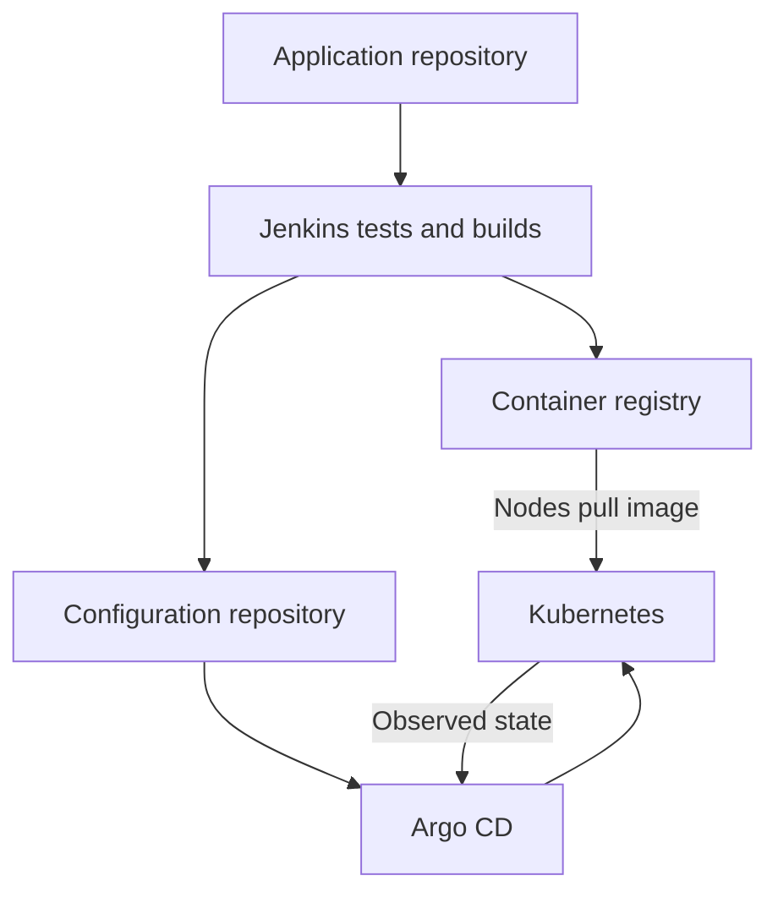

# GitOps & Argo CD — Quick Interview Revision

Based on the topics in KodeKloud’s **GitOps with ArgoCD** course and our course walkthrough. Examples use SwiftPay. This is a revision sheet, not a video transcript; demos are consolidated and administrative course entries are omitted.

## 1. Your 30-second interview answer

> GitOps manages desired system configuration through versioned declarations and continuous reconciliation. In a Kubernetes delivery workflow, CI tests the application, builds an image, and updates deployment configuration in Git. Argo CD retrieves that configuration, renders manifests when needed, compares them with Kubernetes, and synchronizes according to policy. Kubernetes runs the workload; Argo CD reports synchronization and resource health.

## 2. Foundations and tool boundaries

| Concept | What to remember |
|---|---|
| DevOps | Broad practices for developing, delivering, and operating software. |
| GitOps | An operating approach based on declared, versioned desired state and reconciliation. |
| CI | Tests code and builds artifacts such as container images. |
| Argo CD | Continuous delivery and reconciliation of Kubernetes resources. |
| Helm / Kustomize | Produce deployment manifests; Argo CD can consume their output. |
| Terraform | Provisions infrastructure such as networks and Kubernetes clusters. |
| Flux | Another Kubernetes GitOps controller toolkit. |

**Four GitOps principles:** declarative state; versioned and immutable history; automatic retrieval; continuous reconciliation.

**Push deployment:** a pipeline updates Kubernetes directly and needs suitable cluster access.

**Pull deployment:** a controller retrieves desired configuration and updates the cluster. With automatic sync, CI can finish by updating Git without calling the deployment API.

**Benefits:** reviews, traceability, reproducible configuration, drift detection, and less manual deployment work.

**Trade-offs:** incorrect configuration can propagate automatically; secrets need special handling; repository design and controller ownership matter; configuration rollback cannot restore database contents.

## 3. Architecture and installation

| Component | Main job |
|---|---|
| API server (`argocd-server`) | UI/API access, authentication, and user operations. |
| Repository server | Fetches sources and generates manifests from Helm, Kustomize, or plugins. |
| Application controller | Compares desired/live resources and performs reconciliation. |
| Redis | Caches data used by Argo CD. |
| Dex | Identity-provider integration when configured. |
| ApplicationSet controller | Generates Applications from templates and inputs. |
| Notifications controller | Sends configured application notifications. |

**Installation choices:** standard multi-user or minimal core; non-HA or HA; cluster-level or namespace-scoped initial permissions. Packaging can use manifests or Helm. HA improves Argo CD availability, not automatically application availability.

**Setup sequence:** working cluster → install Argo CD → check Pods → expose server → install CLI → authenticate. The server runs in Kubernetes; the CLI runs on your machine.

## 4. Application, AppProject, and declarative configuration

- **Application:** source + revision + path/chart + destination + sync policy. It can manage many resources.
- **AppProject:** groups Applications and restricts repositories, destinations, resource types, and project roles.
- **Namespace:** Kubernetes scope for namespaced resources; an AppProject is a separate concept.
- **Declarative setup:** store Application, AppProject, and settings manifests as code.
- **UI/CLI creation:** alternative ways to create the same underlying Application.

```yaml
apiVersion: argoproj.io/v1alpha1
kind: Application
metadata:
  name: swiftpay-dev
  namespace: argocd             # Location of the Application object
spec:
  project: default
  source:
    repoURL: https://github.com/example/swiftpay-config.git
    targetRevision: main       # Git branch, tag, or commit
    path: k8s/dev              # Workload manifests in this directory
  destination:
    server: https://kubernetes.default.svc
    namespace: swiftpay-dev    # Destination for workload resources
  syncPolicy:
    automated:
      prune: true
      selfHeal: true
    syncOptions:
      - CreateNamespace=true
```

The repository is illustrative. The project policy and Argo CD’s Kubernetes permissions must permit the deployment. Private repositories also need configured repository credentials.

## 5. Reconciliation and synchronization

| Term / setting | Meaning |
|---|---|
| Desired state | Configuration generated from the declared source. |
| Live state | Configuration currently present in Kubernetes. |
| Refresh | Recalculate desired/live differences. |
| Sync | Apply changes toward desired state. |
| Manual sync | A user or external action starts synchronization. |
| Automatic sync | Deploy detected desired-state changes automatically. |
| `selfHeal: true` | Correct detected drift caused by live changes. |
| `prune: true` | Permit automatic deletion of managed resources removed from desired configuration. |

**Example:** Git declares three replicas; someone changes the Deployment to one. Argo CD detects drift. Self-heal can restore three.

**Different responsibility:** when a Pod disappears, Kubernetes can replace it through its own controllers; Argo CD need not redeploy anything.

**Webhook:** a Git event requests an earlier refresh. Argo CD still retrieves the source and follows its sync policy. A webhook does not itself enable auto-sync.

**Do not assume auto-sync enables pruning or self-heal.** These controls are separate. A failed sync is not guaranteed to retry forever; retries have their own policy.

### Sync options worth remembering

| Option | Purpose |
|---|---|
| `CreateNamespace=true` | Create the destination namespace if needed and permitted. |
| `ApplyOutOfSyncOnly=true` | Apply only differing resources during selective sync. |
| `PruneLast=true` | Prune after earlier deployment waves finish. |
| `ServerSideApply=true` | Use Kubernetes server-side apply. |
| `Replace=true` | Use replace/create operations; can be disruptive. |
| `FailOnSharedResource=true` | Fail if another Application already manages a resource. |
| `RespectIgnoreDifferences=true` | Respect configured ignored fields during synchronization. |
| `SkipDryRunOnMissingResource=true` | Skip dry-run for a missing resource type; does not install its CRD. |

## 6. Health, hooks, and deployment order

**Synced = configuration matches. Healthy = assessed resource health checks pass.**

An Application can be **Synced but Degraded**, such as when the desired Deployment exists but its rollout fails.

| Health state | Meaning |
|---|---|
| Healthy | Assessed checks pass. |
| Progressing | Working toward readiness. |
| Degraded | A failure condition is reported. |
| Suspended | Intentionally paused. |
| Missing | An expected resource is absent. |
| Unknown | Health cannot be determined. |

**Custom health:** Lua checks inspect resource fields, usually status/conditions, and return health results. Use this for custom resources that need explicit assessment. It does not replace container probes or end-to-end tests.

**Hooks:** `PreSync` runs before main resources; `Sync` runs during synchronization; `PostSync` follows successful synchronization and health; `SyncFail` handles failure.

**Waves:** numeric priorities order resources within sync phases; lower numbers precede higher numbers. Example: prerequisites before dependent workloads. Deployment order alone does not guarantee migration compatibility.

## 7. App of Apps, Helm, and multiple clusters

| Pattern | Interview explanation |
|---|---|
| Single Application | One Application manages a set of Kubernetes resources. |
| App of Apps | A parent Application manages child Application definitions. Children deploy their own resources. |
| ApplicationSet | A controller generates Applications from a template and inputs such as cluster or Git data. |
| Multi-cluster | Register destinations and create an Application per deployment destination; generation can automate repetition. |

**Parent synced does not mean every child is healthy.** Each child has its own sync policy. Parent repositories can carry powerful permissions and need controlled ownership.

**Helm integration:** Argo CD normally runs `helm template` to generate manifests, then manages those resources itself. It does not create the same release lifecycle as running `helm install`/`helm upgrade` directly.

```yaml
# Application source fragment: chart stored in Git
source:
  repoURL: https://github.com/example/swiftpay-config.git
  targetRevision: main
  path: charts/swiftpay
  helm:
    valueFiles:
      - values-dev.yaml
```

- **Git source:** `targetRevision` identifies a Git revision.
- **Helm repository source:** `targetRevision` identifies a chart version.
- **Image version:** separately specified in the rendered workload, often through chart values.
- **Remote cluster:** Argo CD needs API connectivity and suitable credentials. Registering a cluster does not create it.

## 8. Users, RBAC, and SSO

**Authentication = identity. Authorization = permissions.**

Local accounts are configured in `argocd-cm`; global Argo CD RBAC policies use `argocd-rbac-cm`. AppProjects can also define project roles.

```text
p, role:payments-deployer, applications, get, payments/*, allow
p, role:payments-deployer, applications, sync, payments/*, allow
g, aditya, role:payments-deployer
```

`p` grants a permission; `g` assigns a user/group to a role. This example grants view/sync access in the payments project. Other memberships and default policies may grant additional access.

**Argo CD RBAC:** user actions through Argo CD. **Kubernetes RBAC:** actions allowed against the Kubernetes API. Project restrictions do not grant missing Kubernetes permissions.

**SSO:** Okta authenticates the user; Dex can broker that identity; Argo CD maps identity/group claims to roles. Dex is optional where direct OIDC integration is used. Successful login does not imply permission to deploy.

## 9. Secrets: distinguish the three responsibilities

| Tool | How it works | Main point |
|---|---|---|
| Sealed Secrets | `kubeseal` encrypts a Secret; Git stores a `SealedSecret`; a controller decrypts it in the cluster. | Protect and back up controller keys; protect the resulting Kubernetes Secret too. |
| HashiCorp Vault | Central secret storage/generation with authentication and path policies. | Supports static and, where configured, dynamic credentials. |
| Argo CD Vault Plugin | Resolves placeholders from a secret backend during manifest generation. | Argo CD’s rendering path has access to the resolved values. |

**Base64 is encoding, not encryption.** Plaintext Secret manifests should not be committed.

Vault concepts: **auth method** proves identity; **policy** grants path access; **secrets engine** stores/generates values; **token** represents authorized access.

Plugin commands such as `argocd-vault-plugin generate ./manifests` output resolved YAML. Do not expose that output in Git or logs. Current custom plugin integration uses a repository-server sidecar.

Changing a secret in Vault does not guarantee an immediate workload restart; refresh, sync, and application consumption behavior matter.

## 10. Metrics, monitoring, alerts, and notifications

| Tool / mechanism | Job |
|---|---|
| Argo CD metrics | Expose application state and controller operational measurements. |
| Prometheus | Scrapes/stores metrics and evaluates alert rules. |
| Grafana | Visualizes data from sources such as Prometheus. |
| Alertmanager | Groups, deduplicates, routes, silences, and inhibits alert notifications. |
| Argo CD Notifications | Sends messages based on application triggers and subscriptions. |

Recognize `argocd_app_info` (health/sync labels), `argocd_app_sync_total` (sync count), `argocd_app_reconcile` (reconciliation timing), and `argocd_cluster_connection_status` (connectivity).

**Notifications model:** trigger + template + service + subscription. Example: successful sync → deployment message → Slack → selected channel.

**Alert example:** an Application stays degraded for five minutes. Prometheus evaluates the condition; Alertmanager delivers it. Argo CD health does not measure every business transaction.

## 11. CI/CD with Jenkins and repository separation



**Pipeline:** checkout → test → build image → push immutable tag/digest → update deployment configuration → review/merge → Argo CD sync → Kubernetes rollout → assess health.

| Repository | Typical contents |
|---|---|
| Application | Java/React source, tests, Dockerfile, Jenkinsfile. |
| Deployment configuration | Kubernetes YAML, Helm values/charts, Kustomize overlays, Argo CD definitions. |
| Infrastructure, if separate | Terraform for VPCs, clusters, IAM, and other cloud resources. |

A deployment configuration repository is often called an infra repository, but it need not contain Terraform. Repository boundaries are a design choice.

**Why separate source/config?** Different permissions, cleaner deployment history, configuration-only changes without rebuilding, and fewer pipeline trigger loops. Separation is useful, not mandatory.

**Jenkinsfile:** `agent` chooses execution location; `stages` organize work; `steps` execute tasks; `environment` supplies variables; credential bindings supply secrets; `post` handles outcomes.

## 12. Essential commands

Examples assume installation, authentication, and matching names. Commands that sync or register clusters change state.

```bash
# Inspect installation and access a local lab server
kubectl get pods -n argocd
kubectl port-forward -n argocd svc/argocd-server 8080:443

# Run in another terminal while port-forward stays active
argocd admin initial-password -n argocd
argocd login localhost:8080

# Inspect Applications, differences, and history
argocd app list
argocd app get swiftpay-dev
argocd app diff swiftpay-dev
argocd app history swiftpay-dev

# Deploy and wait for synchronization and health
argocd app sync swiftpay-dev
argocd app wait swiftpay-dev --sync --health

# Apply a declarative Application definition
kubectl apply -f application.yaml

# Register an existing kubeconfig context; inspect destinations
argocd cluster add production-context --name production
argocd cluster list

# Inspect workload problems in the destination cluster context
kubectl get pods -n swiftpay-dev
kubectl describe deployment swiftpay -n swiftpay-dev
kubectl get events -n swiftpay-dev --sort-by=.lastTimestamp
```

## 13. Rapid interview questions and traps

| Question | Short answer |
|---|---|
| Does Argo CD build images? | No; CI or another build system produces them. |
| Does pushing a new image deploy it? | Not by itself for an ordinary Git-backed Application; desired configuration must reference the change. |
| Does a webhook enable automatic deployment? | No; it prompts refresh, while the sync policy controls deployment. |
| Does auto-sync imply pruning/self-heal? | No; configure those separately. |
| Can Synced and Degraded occur together? | Yes; configuration can match while the rollout is unhealthy. |
| Does Argo CD restart every failed Pod? | Kubernetes controllers and kubelet handle Pod lifecycle; Argo CD reconciles managed configuration. |
| What if an HPA changes replicas? | Define field ownership so GitOps does not repeatedly fight the HPA. |
| How do you roll back with GitOps? | Revert desired configuration to a known-good version and reconcile it. |
| Can history rollback run with auto-sync enabled? | Argo CD’s documented rollback operation requires auto-sync to be disabled. |
| Does reverting Git undo a migration? | No; database recovery and compatibility require a separate plan. |
| What if Argo CD is unavailable? | Existing workloads can keep running; Argo CD-driven deployment/reconciliation pauses while unavailable. |
| Does ApplicationSet create clusters? | It generates Application objects; cluster provisioning is a separate responsibility. |

## 14. Troubleshooting by symptom

| Symptom | First checks |
|---|---|
| OutOfSync | Desired/live diff, source revision/path, manual edits, sync policy. |
| Manifest generation error | Repository access, Helm/Kustomize inputs, chart dependencies, plugin configuration. |
| Synced but Degraded | Pod events, image pulls, application logs, probes, resources, rollout conditions. |
| Permission denied | User RBAC, AppProject policy, destination Kubernetes RBAC, repository credentials—identify which layer denied access. |
| Destination unreachable | API endpoint, network route, TLS trust, credentials. |
| Deleted manifest remains live | Pruning policy and resource-level exclusions/confirmation settings. |
| Manual changes keep disappearing | Self-heal or another sync/controller is restoring declared values. |
| Slack message missing | Trigger, subscription, service config, token permissions, bot/channel access. |

## Reference links

- [KodeKloud course](https://learn.kodekloud.com/learn/courses/gitops-with-argocd)
- [OpenGitOps principles](https://opengitops.dev/)
- [Argo CD concepts](https://argo-cd.readthedocs.io/en/stable/core_concepts/)
- [Automated sync](https://argo-cd.readthedocs.io/en/stable/user-guide/auto_sync/) · [Sync options](https://argo-cd.readthedocs.io/en/stable/user-guide/sync-options/) · [Health checks](https://argo-cd.readthedocs.io/en/stable/operator-manual/health/)
- [Declarative setup](https://argo-cd.readthedocs.io/en/stable/operator-manual/declarative-setup/) · [Helm](https://argo-cd.readthedocs.io/en/stable/user-guide/helm/) · [RBAC](https://argo-cd.readthedocs.io/en/stable/operator-manual/rbac/)
- [Sealed Secrets](https://github.com/bitnami/sealed-secrets) · [Vault plugin](https://argocd-vault-plugin.readthedocs.io/en/stable/)
- [Metrics](https://argo-cd.readthedocs.io/en/stable/operator-manual/metrics/) · [Notifications](https://argo-cd.readthedocs.io/en/stable/operator-manual/notifications/) · [CI integration](https://argo-cd.readthedocs.io/en/stable/user-guide/ci_automation/)
